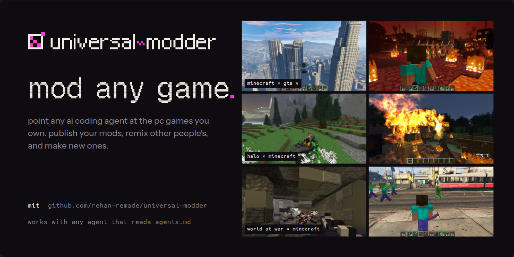
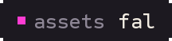
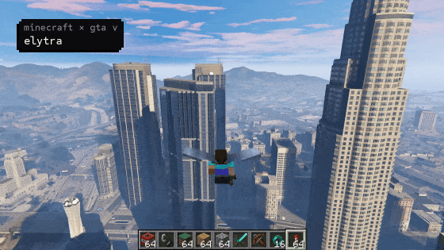
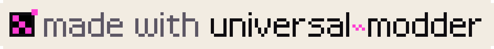

<p align="center">
  
</p>

<p align="center">
  <b>一套技能、工具与共享知识库，让任意 AI 编码 agent 改造你拥有的几乎任何 PC 游戏。</b><br>
  agent 找到游戏，摸清引擎与路线，阅读真实代码，构建 mod，用 <a href="https://fal.ai">fal</a> 生成美术、3D 与声音，
  在运行中的游戏里实测，剪出视频，再把自己学到的写下来，交给下一个 agent。
</p>

<p align="center">
  <a href="https://discord.com/invite/sEZWaf7vV"></a>
  <a href="#安装"></a>
  <a href="knowledge/INDEX.md"></a>
  <a href="https://fal.ai"></a>
  <a href="LICENSE"></a>
</p>

<p align="center">
  
</p>

<p align="center"><b>即将到来：mod 中心。</b>发布你的 mod、混改别人的 mod，并创造新的 mod。<br>
  分享你的作品、获得帮助、持续关注：</p>
<p align="center">
  <a href="https://discord.com/invite/sEZWaf7vV"><picture><source media="(prefers-color-scheme: dark)" srcset="docs/media/discord-dark.svg"></picture></a>
</p>

## 安装

选择你的 agent。每种 agent 拿到的都是同一套技能（Agent Skills 格式）、fal MCP 服务器和 `um` CLI。

| Agent | 安装 |
|---|---|
| **Claude Code** | `/plugin marketplace add rehan-remade/universal-modder`<br>`/plugin install universal-modder@universal-modder` |
| **Codex** | `codex plugin marketplace add rehan-remade/universal-modder`<br>`codex plugin add universal-modder@universal-modder` |
| **Gemini CLI** | `gemini extensions install https://github.com/rehan-remade/universal-modder` |
| **VS Code / Copilot** | 启用 `chat.plugins.enabled`，运行 **Chat: Install Plugin From Source**，填入本仓库地址 |
| **Cursor** | Cursor 插件市场，或直接 clone（Cursor 读取 `AGENTS.md` 和 `.cursor/mcp.json`） |
| **OpenCode** | Clone 后在其中运行 `opencode`（`opencode.json` 会装好技能与 fal MCP 服务器） |
| **仅装技能**<br>（任意 agent） | `npx skills add https://github.com/rehan-remade/universal-modder` |
| **其他任意工具** | `git clone https://github.com/rehan-remade/universal-modder`，然后在里面启动你的 agent |

> **🀄 中文版安装**：把上面命令里的 `rehan-remade/universal-modder` 换成 `bayshier/universal-modder-zh` 即可，例如 Claude Code：
> `/plugin marketplace add bayshier/universal-modder-zh` → `/plugin install universal-modder@universal-modder`。
> 本仓库为纯汉化镜像，技能与代码逻辑与上游逐字节一致（详见文末「汉化说明」）。

在 clone 里，每个 agent 都能在自己习惯的位置找到技能：`.agents/skills`（Codex、Gemini CLI、
Copilot、Cursor、OpenCode）和 `.claude/skills`（Claude Code）都是 `skills/` 的拷贝。说明集中在
`AGENTS.md`，`CLAUDE.md` 和 `GEMINI.md` 都指向它。MCP 配置在 `.mcp.json`、`.codex/config.toml`、
`.cursor/mcp.json`、`.vscode/mcp.json` 和 `opencode.json`（它还把 OpenCode 指向 `skills/`）。

**`um` CLI。** 插件安装和 clone 会自动把它放进 PATH。其他场景：
```bash
uv tool install git+https://github.com/rehan-remade/universal-modder     # 或：pipx install git+...
```
**素材生成**需要一个 [fal API 密钥](https://fal.ai/dashboard/keys)，fal MCP 服务器和 `um fal` 都靠它
（没有密钥时，`um comfy` 可以用本地 ComfyUI 服务器出图）：
```bash
export FAL_KEY=...
```
另外还需要 Git、Python 3.10+ 和 ffmpeg。推荐用 `uv`。3D → 精灵图渲染需要 Blender。
Windows 游戏可在原生环境或 WSL 中驱动。

## 试一试
> 改造 Terraria：加一个追踪导弹发射器和一颗能把世界炸出弹坑的战术核弹。精灵图用 fal 生成。

> 给《帝国时代 II》做一个新文明，自带从 3D 渲染出来的特色单位。

> 把真正的 Minecraft 塞进 GTA V 剧情模式。Minecraft 的镜头跟着 GTA 走，它的 TNT 能炸飞 GTA 的车。

> 把我 Halo 安装里的疣猪号搬进 Minecraft，炮塔上还得坐个机枪手。

> `C:\Games\Foo` 是什么引擎？以前有人改过它吗？

agent 从 **mod-any-game** 技能起步，每次都跑同一个闭环：
1. 检索知识库；
2. 侦察，然后选定路线；
3. 搭一个安全的实验环境（存档先备份）；
4. 读真实代码；
5. 做出一个能跑的最小切片；
6. 生成素材；
7. 在真实游戏里验证；
8. 录像；
9. 打包；
10. 给下一个 agent 写一篇实战笔记。

## 一个 AI 写给 AI 的知识库
[`knowledge/`](knowledge/) 存的是**实战笔记**：具体某款游戏当年是怎么被改、被反编译、被逆向的。
每篇笔记包含：
- 确认可用的精确版本；
- 走的路线，以及为什么走它；
- 引擎的真实行为；
- 怎么验证的；
- 踩过的坑（症状 → 原因 → 解法）。

**每个完成 mod 的 agent 都可以带着自己的笔记开一个 pull request**，让下一个 agent 从上一次停下的
地方继续，而不是重新踩一遍同样的坑。

```bash
um kb search "grand theft auto"                 # 动手前：查先例（仓库外也能用）
um kb new --game "Hades II" --title "A new boon god" --from-scan hades --agent "Codex (gpt-6)"
um kb check knowledge/games/hades-ii/a-new-boon-god.md
um kb pr knowledge/games/hades-ii/a-new-boon-god.md --yes    # 你的主人点头后：建分支、推送、开 PR
```
去逛逛 [`knowledge/INDEX.md`](knowledge/INDEX.md)。任何游戏都欢迎。给人类和 AI 的贡献规则在
[`CONTRIBUTING.md`](CONTRIBUTING.md)：不带游戏文件、不带反编译转储、不作弊害人，状态与验证必须诚实。

来自社区的几篇笔记：
- [Portalcraft：装进 Portal 2 的真 Minecraft](knowledge/games/portal-2/portalcraft-minecraft-inside-portal-2.md)
- [Halo 3 的武器、星盟载具与地图移植进 Minecraft](knowledge/games/halo-3-mcc/halo-3-weapons-covenant-vehicles-and-maps-ported-into-minecr.md)
- [Bloons TD 6 进 Minecraft，游戏规则做成无头模拟](knowledge/games/minecraft/bloons-td-6-in-minecraft.md)
- [艾尔登法环的 CS2 风格离线改造，原生 Rust DLL 实现](knowledge/games/elden-ring/cs2-conversion-of-elden-ring-offline-native-rust-dll-via-me3.md)

## 里面有什么

**技能**（`skills/`，Agent Skills 格式）

<table>
  <thead><tr><th width="200">技能</th><th>它做什么</th></tr></thead>
  <tbody>
    <tr><td><a href="skills/mod-any-game"><code>mod-any-game</code></a></td><td>完整闭环、硬性安全规则，以及 <b>12 份引擎作战手册</b>：Unity、Unreal、.NET/XNA（Terraria、星露谷、Celeste）、Godot、Source 1/2、Bethesda、Minecraft、AoE2/Genie、RE Engine/FromSoft/GTA/赛博朋克/BG3、原生 C++、独立引擎（GameMaker、RPG Maker、Ren'Py、P 社、Doom、HTML5、LÖVE、Java）、复古 Decomps</td></tr>
    <tr><td><a href="skills/game-recon"><code>game-recon</code></a></td><td>既有实战笔记、引擎与版本、托管还是原生、反作弊、加载器、存档目录、社区路线 → 产出 <code>MODDING_PLAN.md</code></td></tr>
    <tr><td><a href="skills/game-research-websearch"><code>game-research-websearch</code></a></td><td>能在死论坛废墟里存活的开放网络调研：Wayback/archive.today、GitHub/代码与 Nexus/创意工坊/Thunderstore API、Reddit/YouTube、登录墙内容交接、截图留证</td></tr>
    <tr><td><a href="skills/reverse-engineering"><code>reverse-engineering</code></a></td><td>ILSpy / Cpp2IL / Vineflower / Ghidra、走 MCP 的 IDA / Cheat Engine / Frida / RenderDoc；逆向一个文件格式，并用往返转换证明它</td></tr>
    <tr><td><a href="skills/fal-assets"><code>fal-assets</code></a></td><td>真透明通道的精灵图、风格一致的变体、像素画、无缝纹理、PBR 贴图、图生 3D、自动绑骨、音效、音乐、语音、过场视频</td></tr>
    <tr><td><a href="skills/asset-pipeline"><code>asset-pipeline</code></a></td><td>从美术到引擎精确帧：抠图、最近邻适配、调色板、精灵表、队伍色蒙版、3D → 8/16 朝向精灵</td></tr>
    <tr><td><a href="skills/game-automation"><code>game-automation</code></a></td><td>启动、截图（不惊动 GPU）、安全点击/输入、窗口化、崩溃报告器清理、游戏内 agent 桥</td></tr>
    <tr><td><a href="skills/showcase-video"><code>showcase-video</code></a></td><td>只带游戏声音录窗口、挑高光时刻、按 EDL 剪出有风格的视频</td></tr>
    <tr><td><a href="skills/mashup-mods"><code>mashup-mods</code></a></td><td>游戏套游戏：内容移植、透传 mod（完整案例：Minecraft × GTA V）、把 decomp 当库用、重实现</td></tr>
    <tr><td><a href="skills/publish-mod"><code>publish-mod</code></a></td><td>Lint、按平台打包、署名致谢、发布帖</td></tr>
    <tr><td><a href="skills/share-field-notes"><code>share-field-notes</code></a></td><td>检索知识库、写你自己的笔记、开 PR</td></tr>
  </tbody>
</table>

**`um` CLI**（Python）。每个命令都有带示例的 `--help`。

<!-- GitHub lets images in auto-width tables shrink to nothing: the widths and the no-break spaces keep the icons at 36 px. -->
<table>
  <thead><tr><th width="62">&nbsp;&nbsp;&nbsp;&nbsp;&nbsp;&nbsp;&nbsp;&nbsp;&nbsp;&nbsp;</th><th width="170">命令</th><th>它做什么</th></tr></thead>
  <tbody>
    <tr><td align="center"><picture><source media="(prefers-color-scheme: dark)" srcset="docs/media/icons/scan-dark.svg"></picture></td><td><code>um scan</code></td><td>找到 Steam/Epic/Xbox 安装；指纹识别引擎与版本、.NET 还是原生、反作弊、已装加载器、存档目录，并排出推荐路线</td></tr>
    <tr><td align="center"><picture><source media="(prefers-color-scheme: dark)" srcset="docs/media/icons/fal-dark.svg"></picture></td><td><code>um fal</code></td><td><code>sprite</code>、<code>image</code>、<code>edit</code>、<code>rmbg</code>、<code>pixelate</code>、<code>upscale</code>、<code>texture</code>、<code>pbr</code>、<code>model3d</code>、<code>rig</code>、<code>sfx</code>、<code>music</code>、<code>voice</code>、<code>video</code>、<code>run</code>、<code>search</code>、<code>schema</code>、<code>price</code>。纯 REST，每次生成都留清单</td></tr>
    <tr><td align="center"><picture><source media="(prefers-color-scheme: dark)" srcset="docs/media/icons/comfy-dark.svg"></picture></td><td><code>um comfy</code></td><td><code>status</code>、<code>image</code>（<code>--sprite</code> 顺手抠图）、<code>run</code>（跑任何用 Export (API) 存的工作流）。图片来自本地 ComfyUI 服务器，无需 API 密钥</td></tr>
    <tr><td align="center"><picture><source media="(prefers-color-scheme: dark)" srcset="docs/media/icons/sprite-dark.svg"></picture></td><td><code>um sprite</code></td><td><code>cutout</code>、<code>fit</code>、<code>pixelate</code>、<code>palette</code>、<code>sheet</code>、<code>slice</code>、<code>frames</code>、<code>team-mask</code>、<code>seamless</code>、<code>preview</code></td></tr>
    <tr><td align="center"><picture><source media="(prefers-color-scheme: dark)" srcset="docs/media/icons/render3d-dark.svg"></picture></td><td><code>um render3d</code></td><td>用 Blender 按《帝国时代 II》等游戏机位把 GLB 渲染成精灵帧（<code>aoe2</code>、<code>iso8</code>、<code>trueiso</code>、<code>topdown</code>、<code>side</code>、<code>turntable</code>）</td></tr>
    <tr><td align="center"><picture><source media="(prefers-color-scheme: dark)" srcset="docs/media/icons/win-dark.svg"></picture></td><td><code>um win</code></td><td><code>shot</code>、<code>record</code>（gfxcapture + 进程环回音频）、<code>drive</code>（只到达游戏的输入）、<code>ps</code>、<code>kill</code>、<code>launch</code>、<code>reg</code></td></tr>
    <tr><td align="center"><picture><source media="(prefers-color-scheme: dark)" srcset="docs/media/icons/video-dark.svg"></picture></td><td><code>um video</code></td><td><code>contact</code> 缩略图表、<code>compile</code>（EDL → 带标题、卡节拍的成片配乐）、<code>mux</code>、<code>beats</code>、<code>first-frame</code></td></tr>
    <tr><td align="center"><picture><source media="(prefers-color-scheme: dark)" srcset="docs/media/icons/backup-dark.svg"></picture></td><td><code>um backup</code></td><td>存档目录的快照、diff 与恢复</td></tr>
    <tr><td align="center"><picture><source media="(prefers-color-scheme: dark)" srcset="docs/media/icons/publish-dark.svg"></picture></td><td><code>um publish check</code></td><td>拦下游戏文件、反编译代码和泄漏密钥</td></tr>
    <tr><td align="center"><picture><source media="(prefers-color-scheme: dark)" srcset="docs/media/icons/kb-dark.svg"></picture></td><td><code>um kb</code></td><td>知识库全家桶：<code>search</code>、<code>show</code>、<code>new</code>、<code>check</code>、<code>index</code>、<code>sync</code>、<code>pr</code></td></tr>
  </tbody>
</table>

包里还自带两个免构建的 Windows 工具（`um/ps1/`）：WinDrive 输入注入和 ProcLoopback 仅游戏音频，
都是内嵌 C# 的 PowerShell。

<p align="center"></p>

## 用它做出来的
- **[examples/terraria-tmodloader](examples/terraria-tmodloader)**：tModLoader 的 *Fal Arsenal*。
  - 武器：追踪导弹发射器、战术核弹（弹坑 + 蘑菇云）、链状闪电步枪、黑洞枪和轨道打击。
  - 三种新敌人，外加两阶段的无人机母舰 Boss。
  - 每一张精灵图都来自 fal。
- **[examples/aoe2-de-civ](examples/aoe2-de-civ)**：《帝国时代 II》DE 的 *San Franciscans*。
  - 新文明，特色单位是 Robotaxi，还有快递无人机，按 AoE2 的机位从 fal 图生 3D 模型渲染。
  - 一个泛美金字塔奇迹建筑。
  - 一个逆向出来的 `.sld` 精灵写入器。
- **[examples/minecraft-gta5-passthrough](examples/minecraft-gta5-passthrough)**：把真 Minecraft 塞进
  GTA V 剧情模式。
  - 一个 Fabric mod 和一个 ScriptHookV + ReShade 插件，通过本地 WebSocket 交换镜头、地形与事件。
  - Minecraft 的颜色 + 深度被深度合成进 GTA 的画面。
  - Minecraft 的 TNT、箭和烟花变成 GTA 的爆炸与子弹，Minecraft 生物还会围殴警察。

每个案例都配了一篇写满非显然经验的实战笔记：[knowledge/INDEX.md](knowledge/INDEX.md)。

## 它遵守的规则
- **只碰你拥有的游戏：单机、联机，或你自己架的服务器。** 它拒绝给带反作弊的在线游戏做注入、
  拒绝写针对其他玩家的作弊器，也拒绝绕过反作弊、DRM 或所有权校验。
- **绝不打包游戏文件或反编译代码。** mod 以代码、你自己的素材、补丁或转换器的形式发布。
- **动存档之前先备份**，杀进程只按 PID 来。
- **这些动作之前会先问你**：驱动你的鼠标键盘、往游戏目录装加载器，以及一切发布动作（包括 PR）。

完整规则推演见 [`skills/mod-any-game/references/safety.md`](skills/mod-any-game/references/safety.md)。

## 用它做了 mod？
来 [Discord](https://discord.com/invite/sEZWaf7vV) 晒一晒，并把徽章挂到你 mod 的页面上：

<p>
  <a href="https://github.com/rehan-remade/universal-modder"><picture><source media="(prefers-color-scheme: dark)" srcset="docs/media/made-with-dark.svg"></picture></a>
</p>

```markdown
[](https://github.com/rehan-remade/universal-modder)
```
浅色页面请用 `made-with-light.svg`。

## 致谢
- 建立在真实 agent 改造 Terraria、《帝国时代 II》和 GTA V × Minecraft 的会话之上。
- 素材：[fal](https://fal.ai)（GPT Image 2、Nano Banana 2、FLUX、Trellis 2、ElevenLabs……）。
- 站在 tModLoader、genieutils-py、AoE2ScenarioParser、ScriptHookV、ReShade、Fabric、
  BepInEx、Harmony、UE4SS、REFramework、SKSE、ILSpy、Ghidra 和每一个为自己的游戏写文档的 mod
  社区的肩膀上。
- 引擎作战手册也参考了 2026 年 9 月那波 AI 量产 mod 的浪潮，以及作者们在公开场合的讲解。

MIT 许可证。品牌字体：Geist Pixel、Sometype Mono 与 Instrument Sans。视频标题字体：Space Grotesk 与
JetBrains Mono。均遵循 SIL OFL。

## Star 历史

<p align="center">
  <a href="https://github.com/rehan-remade/universal-modder/stargazers"></a>
</p>

## 汉化说明

本仓库是 [rehan-remade/universal-modder](https://github.com/rehan-remade/universal-modder)（MIT）的中文汉化版，基线 commit `5506516`。分层汉化：

- **已翻译（浏览层）**：README、CONTRIBUTING，以及 7 个插件清单/配置里的插件描述（Claude Code、Codex、Cursor、Gemini 等平台的选择器界面会显示这些文字）。
- **保留英文原文（agent 消费层，逐字节一致）**：`skills/` 及其 `.agents/skills`、`.claude/skills` 两份拷贝、`knowledge/` 知识库全部笔记、`AGENTS.md`/`CLAUDE.md`/`GEMINI.md`、`um/` CLI 与 `examples/`。这些是 AI agent 运行时直接消费的指令与代码，保持与上游逐字节一致，保证行为不打折，也方便直接跟进上游更新。

权利与义务随 MIT 许可证，原项目归 Rehan 与 universal-modder 贡献者所有。
